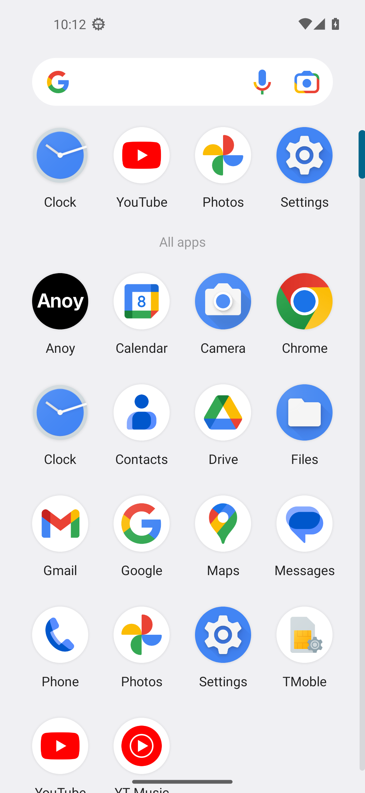
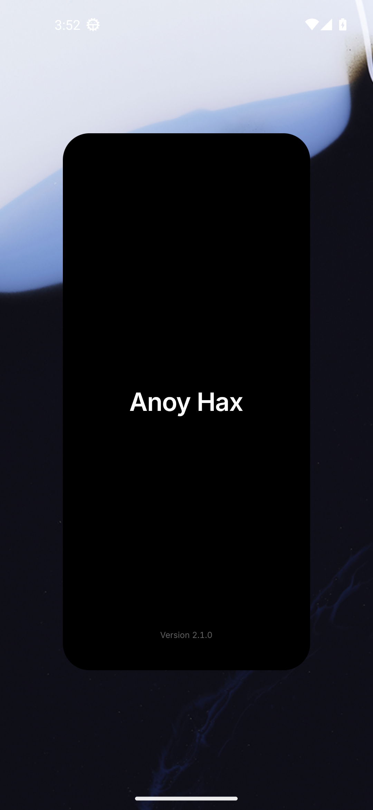
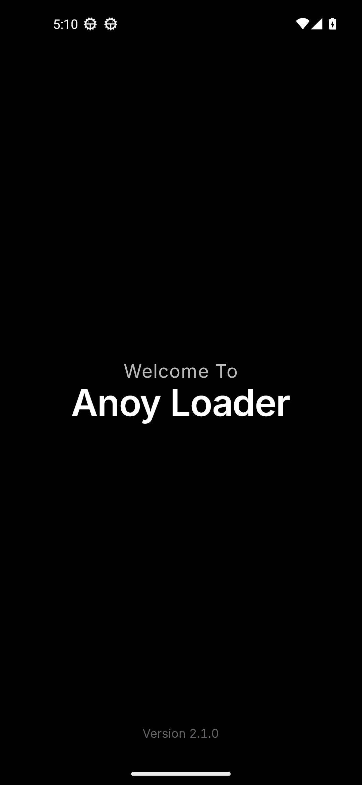
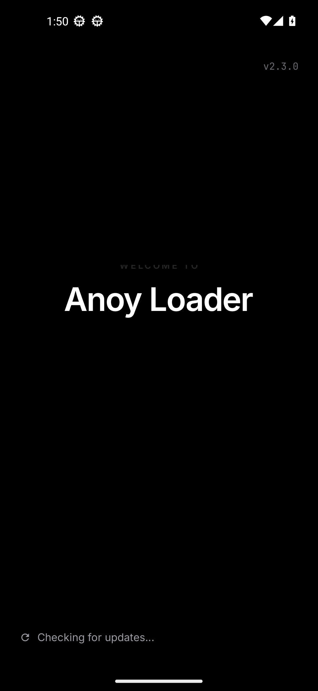
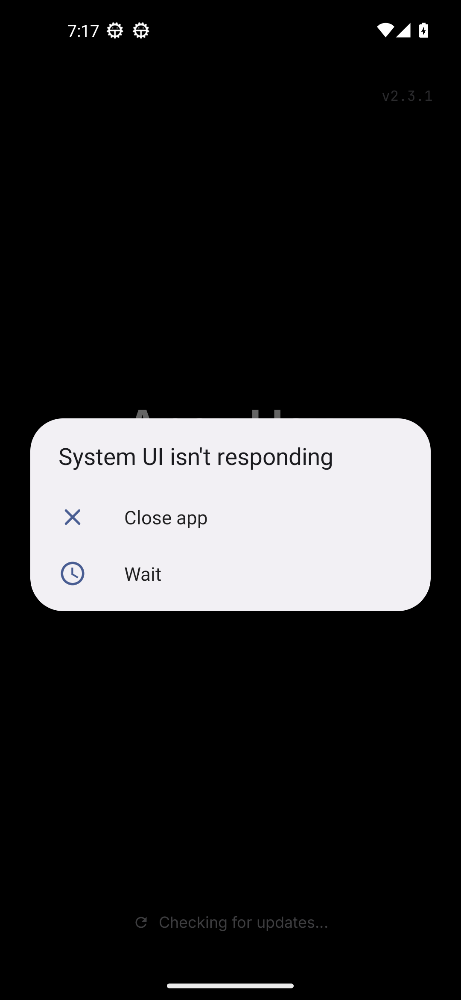
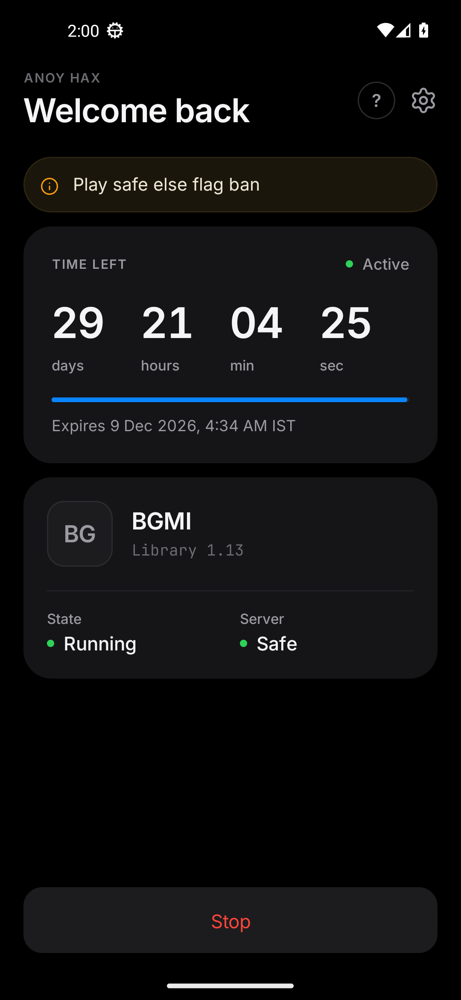
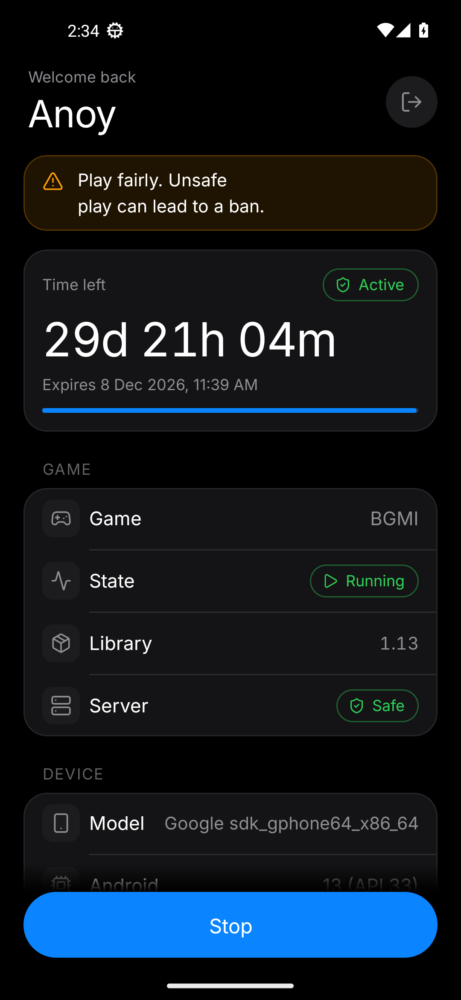
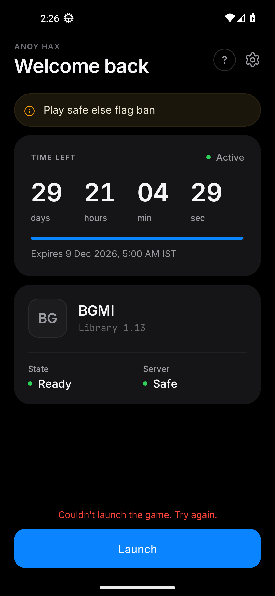
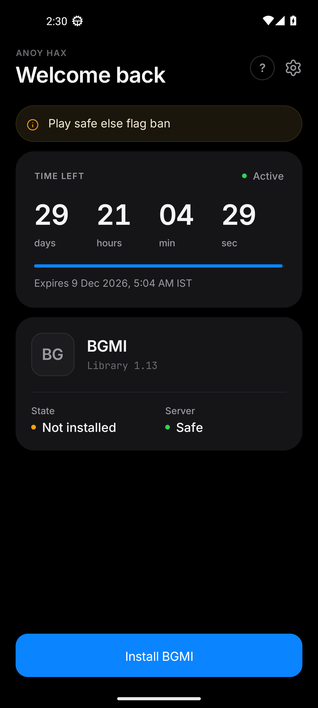
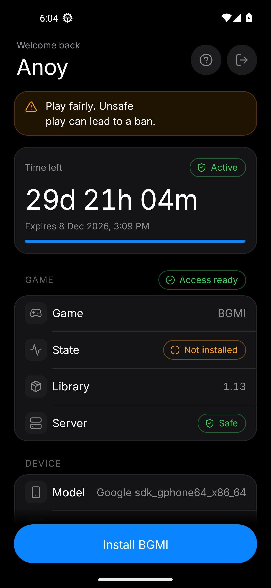

# Follow-ups: Anoy wordmark and splash film, launch error, home tidy

All shots are in [`after/`](after/) and were captured by CI on the API 33
Pixel 5 emulator from the real debug APK. Stills are taken with animations
off; the splash stills are pinned with the debug-only `qa_frame` extra (a film
time in seconds), so they are real frames of the film, not mock-ups.
`after/anim_splash.mp4` is a screen recording of a cold start with animations
on.

## 1. App icon: the word "Anoy", white on black

| App drawer | Recents | Masks, 48 px and enlarged |
|---|---|---|
|  |  |   |

The A monogram, its blue bar and the key are gone. The icon is only the word
**Anoy**, `#FFFFFF` on `#000000`, drawn as vector outlines (not a TextView).
Made by `scripts/brand_wordmark.py` from Inter 4.001, the version the app ships:

- **Weight 660** (SemiBold is 600), text optical size, so it stays crisp at 48 dp.
- **Tracking** -2.5 % of the em; **A–n** tightened a further 3.5 % for the hole
  under the A's open right side. n–o–y keep Inter's own optical spacing.
- **y descender**: the hook is lifted 26 % along the y's own diagonal, tapered
  to nothing at the crotch, so the tail is shorter without getting thinner.
- **Optical centring**: halfway between the ink centroid and the box centre
  horizontally; cap band blended with the ink centroid vertically.
- **Size**: the farthest point is 31 dp from the centre, 2 dp inside the 66 dp
  safe zone. Circle, squircle, rounded-square and teardrop masks never clip a
  letter (red dashes above = safe zone). On a 48 dp icon the word is 40 dp wide
  with a 12 dp cap height.
- The adaptive icon (`drawable-v26`), the legacy rounded square (`drawable`)
  and the system-splash icon (`splash_mark.xml`) are all generated from the
  same outlines. The login screen's key tile is unchanged.
- The emulator has no icon-shape overlays, so the drawer shows the Pixel
  launcher's circle; the other masks are rendered from the vector.

## 2. Splash: "Welcome To Anoy Loader" → "Anoy Hax"

| System splash | Welcome | Greeting dissolving | Loader → Hax mid-dissolve | Final |
|---|---|---|---|---|
|  |  |  |  |  |

The splash is now real TextViews on true black, driven by one animator, so the
three cut moves share one clock. Text changes use the Material 3 emphasized
ease `(0.2, 0, 0, 1)` (gentle start, long settle), and the moving text is
drawn from hardware layers during the film so glyphs are not re-rasterised
every frame. Timings, all named constants in
`SplashActivity`:

| Time | Beat | What moves |
|---|---|---|
| 0.00 s | hand-off | first frame = the system splash wordmark, same place and size (`splash_t000` is identical to `splash_live_cold`); the system splash is removed instantly instead of fading over an empty window |
| 0.00–0.50 s | arrive | "Welcome To / Anoy Loader" fades in (400 ms) and rises 12 dp (500 ms, emphasized decelerate); the system wordmark cross-fades out in 220 ms |
| 0.50–1.20 s | read | hold |
| 1.20 s | leave | "Welcome To" dissolves: fades out while drifting up 10 dp and easing to 98 % (420 ms, smooth ease). No clipping; it only turns invisible once fully transparent |
| 1.28 s | move | "Anoy Loader" eases up so its cap band sits on the true screen centre (460 ms, emphasized decelerate) |
| 1.36 s | swap | "Loader" cross-dissolves into "Hax" in the same slot (start edges aligned, overlapping fades that never dim the slot, a 1.0 ↔ 0.98 breath) while the pair slides to centre. Fade and slide share one 400 ms progress and one smooth ease, so "Anoy" glides sideways once |
| ~1.80–2.85 s | settle | hold "Anoy Hax"; the version stays at the bottom |
| 2.85 s | hand-off | the existing 320 ms cross-fade into sign-in / the update check (done ~3.17 s) |

- "Welcome To" is Inter Regular 20, tracked +4 %, 72 % white. "Anoy",
  "Loader" and "Hax" are Inter SemiBold 40, full white, separate views.
- **Reduced motion** (animations off): the welcome lockup holds 1 s, cuts
  straight to "Anoy Hax", holds 0.7 s and hands off. Shown in
  `splash_reduced_welcome.png` and `splash.png`.
- **Slow start-up**: "Anoy Hax" stays and breathes its opacity very slowly
  (100 → 72 %, 2.4 s). No spinner, bounce, glow or extra logo.
- The splash no longer uses Lottie; `anoy_mark.json` was deleted. The two
  update-check animations are unchanged.

## 3. No false "Couldn't launch the game"

`MAct.launchGame()` used to wrap the launch *and* the after-launch UI in one
`try/catch`, and treated a null launch intent as a failure. Now:

- Once `startActivity` returns, the launch counts as a success. The
  after-launch work (haptic, hiding messages, refreshing the state) is in its
  own `try` and can only log, never show the error.
- With a null intent, or if starting throws, Anoy waits up to 4 s for the game
  to actually start (the container reports it running, or Anoy is sent to the
  background) before reporting a failure. The real exception is logged.
- When you come back to Anoy while the game is running, any stale error is
  cleared. The pre-launch checks and their messages are unchanged.

| Started, back to Anoy | After-launch step throws | Null intent, game running | Real failure |
|---|---|---|---|
|  |  |  |  |

The emulator has no BGMI, so these cases are simulated with the debug-only
`qa_launch` extra. CI fails if a started case shows the error or if a real
failure hides it.

## 4. Home tidy

| Typical phone (411 × 914 dp) | Pixel 5 (393 × 851 dp) |
|---|---|
|  |  |

- Tighter vertical rhythm (rows 56 → 52 dp, section gaps 28 → 24 dp, smaller
  top and card spacing). On a typical phone the DEVICE card ends about 37 dp
  above the Launch bar; CI measures this from the view bounds.
- The notice keeps its last two words together and breaks into even lines, so
  "ban." is never left on its own line.
- Model / Android values stay on one right-aligned line, shrink down to 12 sp,
  then end with "…".
- On the shorter Pixel 5 screen the last DEVICE row still sits under the
  Launch bar until you scroll a little; fitting it there would need more than
  a light clean-up.

## 5. Game files (OBB) copied before launch

`AppManager.copyObbAsync` (called by `MAct.prepareObbThenLaunch()` after the
activation, library and files-access checks) now:

1. Finds the source in `/storage/emulated/0/Android/obb/<pkg>` or
   `getExternalStorageDirectory()/Android/obb/<pkg>`: the newest `main.*.obb`
   plus the newest `patch.*.obb`.
2. Resolves the container folder
   (`MetaStorageManager.obtainAppExternalStorageDir(pkg)/Android/obb/<pkg>`),
   retrying 5 × 600 ms if it is missing or is the device folder.
3. Skips a file only if the container copy is a different canonical file with
   the same name and size; otherwise copies (temp + rename, whole-job percent)
   and verifies.
4. Launch runs only after success. Errors: `error_obb_missing` (folder or main
   OBB not found), `error_obb_copy` with a reason (folder blocked by Android,
   container not ready, write / incomplete / verify failure, no space).

Debug log tag `AppManager`: source, destination, copy / skip per file, sizes,
progress at 0/25/50/75/100 %.

Emulator proof (API 33, fake 320 MB main + 24 MB patch + an older main):
container folder `/storage/emulated/0/Android/obb/com.xlox/scopedStorage/com.pubg.imobile/Android/obb/com.pubg.imobile`
(different from the device folder); first launch copied and verified both
files, then launched; second launch skipped both as current, then launched;
no OBB → "Game files not found", no launch.

**Android 11+ limit:** stock Android only lets "installer" apps read another
app's `Android/obb` folder. Anoy does not ask for "Install unknown apps", so on
such phones the folder is unreadable and Launch says Android is blocking it
(no launch). The emulator copy test turns that access on with a test-only
`appops` switch; the app itself does not request it.

## 6. Permissions

### Requested by Anoy (only these three)

`utils/StorageAccess` (shared by sign in and home), asked in this order for
whichever is missing - sign in asks for the first, home for the rest, Launch
for anything still missing:

| # | Settings name | Permission | How it is asked |
|---|---|---|---|
| 1 | All files access | `MANAGE_EXTERNAL_STORAGE` (Android 11+) | system page `ACTION_MANAGE_APP_ALL_FILES_ACCESS_PERMISSION` (fallback `ACTION_MANAGE_ALL_FILES_ACCESS_PERMISSION`) |
| 2 | Files / Files and media | `READ_EXTERNAL_STORAGE`, `WRITE_EXTERNAL_STORAGE`; on 13+ also `READ_MEDIA_IMAGES/VIDEO/AUDIO` in the same dialog | runtime dialog; once refused for good, Anoy's App info page opens instead |
| 3 | Install unknown apps | `REQUEST_INSTALL_PACKAGES` (Android 8+) | system page `ACTION_MANAGE_UNKNOWN_APP_SOURCES` |

After each answer Anoy checks again and asks for the next missing one; when
all three are granted the existing `startLaunch()` continues (OBB copy, then
launch). Refusing one shows its message ("Allow All files access / Files
access / Install unknown apps for Anoy so game files can be prepared."), no
copy, no launch. "Files" is granted when READ and WRITE are granted (the
media permissions are asked with them but do not block Launch).

**One restart after Install unknown apps (Android 11+).** Android opens the
game's `Android/obb` folder only to an app process started after that switch
is turned on. If the copy finds the folder blocked right after the grant,
Anoy shows "Restarting Anoy to finish setting up game files…", restarts
itself (splash, update check, sign in with the saved key), and when home
opens the interrupted Launch continues by itself (within 10 minutes). No
restart loop: after the restart, a still-blocked folder shows the message.

### Declared only - never requested in this version

Microphone `RECORD_AUDIO`; nearby devices `BLUETOOTH`, `BLUETOOTH_CONNECT`,
`BLUETOOTH_SCAN` and `NEARBY_WIFI_DEVICES` (both `neverForLocation`); appear on
top `SYSTEM_ALERT_WINDOW`; location `ACCESS_COARSE_LOCATION`,
`ACCESS_FINE_LOCATION`; notifications `POST_NOTIFICATIONS`; picture-in-picture
`android:supportsPictureInPicture` on home. Android itself grants
`BLUETOOTH_CONNECT` to apps targeting below Android 12; Anoy never asks.
Normal technical permissions stay (internet, network state, wake lock,
foreground service, installed-apps query, ...).

### Removed

From this manifest: `ACCESS_SUPERUSER`, `ACTION_MANAGE_OVERLAY_PERMISSION`
(not a real permission), `PROCESS_OUTGOING_CALLS` (mundo leftover),
`GOOGLE_AUTH*`. Stripped with `tools:node="remove"` from
`libs/recommendpermission-release.aar` (a manifest-only library that merges
121 permissions): calendar, call logs, camera, contacts and accounts (incl.
`GET_ACCOUNTS`, `MANAGE_ACCOUNTS`, `AUTHENTICATE_ACCOUNTS`, `USE_CREDENTIALS`,
profile / social stream), health (`BODY_SENSORS*`,
`FOREGROUND_SERVICE_HEALTH`), phone (`READ_PHONE_STATE`, `READ_PHONE_NUMBERS`,
`CALL_PHONE`, `ANSWER_PHONE_CALLS`, `USE_SIP`, `ACCEPT_HANDOVER`), physical
activity (`ACTIVITY_RECOGNITION`, the Play services and MIUI step variants),
SMS (`SEND_SMS`, `READ_SMS`, `RECEIVE_SMS`, `RECEIVE_MMS`, `RECEIVE_WAP_PUSH`).

CI checks the built debug and release APKs (`aapt2 dump permissions`, saved
in `qa-logs/permissions-*.txt`): the requested and declared ones present, the
removed ones absent, and no Java code asking for a declared-only permission.


## 7. Polish pass: signing, permission explanations, sign out, game state, licence time

### 7.1 Release signing credentials are no longer in tracked files

- `app/build.gradle` reads the keystore passwords from environment variables
  (`XLOX_STORE_PASSWORD`, `XLOX_KEY_PASSWORD`, optional `XLOX_KEY_ALIAS`,
  `XLOX_STORE_FILE`), falling back to the gitignored `xlox/local.properties`
  (`xlox.storePassword`, `xlox.keyPassword`, ...). Without them the release
  APK is built unsigned instead of failing. The key itself is unchanged.
- `.github/workflows/build-xlox.yml` passes the values in from the repository
  secrets `XLOX_STORE_PASSWORD` and `XLOX_KEY_PASSWORD`. It opens the bundled
  keystore with the secret (`keytool -storepass:env`, nothing printed), checks
  the APK with `apksigner verify`, and **never generates a new key** (the old
  "regenerate if unusable" path is gone - a different key would break
  updates). Without the secrets it still compiles and lints, but skips the
  GitHub release and the `dist/` commit, with a warning on the run.
- `android-ui-qa.yml` passes the same secrets; without them its release APK is
  unsigned and the emulator install re-signs it with a throwaway test key.
- The password was removed from `xlox/README.md`, which now documents the
  variables.
- **Action needed (owner, once):** add the two repository secrets on GitHub
  (Settings → Secrets and variables → Actions → New repository secret), with
  the passwords this keystore has always used. The agent's GitHub access cannot
  create secrets (HTTP 403). Until they exist, CI builds are checked but no new
  APK is published.
  **Done (7 Nov 2026):** the owner added both secrets; signed builds and
  publishing are back on.
- **History:** `app/xlox.jks` is still tracked and the old password remains in
  earlier commits of `build.gradle`, the workflow and the README. History was
  not rewritten (as asked). Anyone with the repository history can sign as this
  key; rotating it would mean a new key and a reinstall for every user, so that
  is left as a decision for later.
- **Verify:** `git grep -n storePassword` shows only the `releaseSigning`
  lookup. A push with the secrets set shows "Release keystore opens with the
  repository secret" and "Release APK is signed with the release key" in
  `build-xlox.yml`.

### 7.2 An explanation before the All files access / Install unknown apps pages

- Right before Anoy opens either settings page (from sign in, home or
  Launch), a dark bottom sheet explains it in plain words: "Anoy needs this to
  prepare game files" / "to install the library update and prepare game files.
  You'll be taken to Settings. Turn it on for Anoy, then come back." Buttons:
  **Continue to Settings** and **Not now**.
- Continue opens the page exactly as before; the order (All files → Files →
  Install unknown apps), the refusal / permanent-denial messages and the
  one-time restart after Install unknown apps are unchanged. The Files runtime
  dialog explains itself and gets no sheet.
- Not now: after Launch it shows the existing refusal message (no copy, no
  launch); when home or sign in asked on their own, the sheet just closes and
  is not shown again in this run.
- Code: `ui/PermissionSheet.java`, `layout/sheet_permission.xml`,
  `MAct.askNextPermission` / `openPermissionPrompt` / `permissionNotNow`,
  `LogAct.requestStorageAccess`.
- **Verify (CI):** `perm_explain_all_files.png` and `perm_explain_install.png`
  show the sheets. The trace has `Permission explained: X` before
  `Permission prompt: X` for ALL_FILES and INSTALL, and the full
  allow → restart → copy → launch path still passes. `home_perm_not_now.png` +
  `perm_not_now` lines show Not now: no settings page, the refusal message.

### 7.3 Sign out vs Forget this key

- The sign-out sheet now says "Your licence key stays saved on this phone, so
  signing back in takes one tap." **Sign out** keeps the saved key (sign in
  opens with it filled in, as before). **Forget this key** (quiet red text
  button) also removes the saved key from this phone, so sign in opens with an
  empty field. Nothing is deleted on the server; the login screen is unchanged.
- **Verify (CI):** `signout_done.png` (field filled) and `forget_key_done.png`
  (field empty). In the trace, `signout saved key: 1` and `forget saved key: 0`
  come from the app's own preferences file.

### 7.4 Game state chip: no misleading "Ready", closed games noticed

- The chip says **Ready** only when Launch has everything it needs: library
  installed, the three permissions granted and the container activated.
  Otherwise it says **Installed** (neutral grey). Not installed / Running are
  unchanged.
- While home is visible, the existing container check (`isAppRunning`) runs
  every 3 s and on return to home. If the game was closed outside Anoy,
  Stop → Launch and the chip leaves Running. Two misses in a row are needed (a
  blip changes nothing). A launch still waiting for confirmation is left alone,
  and the first 30 s after a launch wait for the container to report the game.
  It never shows an error, so the false "Couldn't launch the game" fix is
  untouched. A game started outside Anoy is shown as Running with Stop.
- **Verify (CI):** `game_closed` lines: Stop while the stand-in game runs,
  then (debug `qa_game_ms` closes it after 12 s) Launch with no error and
  `Game: closed outside Anoy, back to Launch`. `home_game_closed.png`.

### 7.5 Licence time refreshes on return to home, with a low-time nudge

- On return to home (at most once a minute) and quietly every 5 minutes while
  home stays open, Anoy re-runs the same licence check sign in uses, so an
  expiry changed on the panel shows up without signing in again. Status and
  notice update too.
- **Expires soon:** from a day before the end (a quarter of the length for
  keys shorter than 4 days) the status chip turns amber "Expires soon" and the
  card shows "Renew now to keep playing without a break." with a **Renew**
  link to the existing Telegram support link. No notifications.
- **Offline / failure:** no network or a VPN → no check at all. A failed check
  keeps the last known time and status and shows a quiet grey "Last checked
  3:04 PM". It never signs out and never stops the game. Behind the scenes, the
  native check resets its values before asking the server, so home keeps the
  last good session in memory for this app run (a restart still signs in, as
  before). Sign in and the refresh never run the check at the same time
  (`LogAct.CHECK_LOCK`). Only the panel's explicit "EXPIRED KEY" answer changes
  the state, to Expired with "Sign in again".
- Splash, sign in and the update gate are unchanged.
- **Verify (CI):** debug `qa_refresh` simulates the panel's answer on return
  to home: `home_licence_extended.png` (29d → 59d),
  `home_licence_soon.png` (Expires soon + Renew), `home_licence_offline.png`
  (29d kept, "Last checked"), `home_licence_expired_by_panel.png`. The
  existing `home_under_day.png` (21 h left of 30 days) also shows the nudge.
- **On a phone:** sign in, change the key's expiry on the panel, switch to
  another app and back - the new time shows. Turn on airplane mode and come
  back - the time stays, with "Last checked".

### Debug-only QA extras added

`qa_saved_key` (stores a saved key), `qa_game_ms` (the stand-in game closes
after N ms), `qa_refresh` (extend | soon | expired | fail). All require the
debug-only `qa_preview`.

## 8. Help, Access chip and "Copy for customer"

### 8.1 Help on home

- A **?** button in the home header (left of Sign out) opens a dark bottom sheet
  in the existing style with three short tips:
  - **Launching the game:** sign in, allow the three access items if asked, then
    Launch. The first time, Anoy copies the game files first.
  - **Files missing or access needed:** turn on All files access, Files and
    Install unknown apps, come back, tap Launch.
  - **Renewing your licence:** Renew on the licence card, or Help on Telegram.
- **Copy support info** first shows exactly what will be copied, then copies it
  only on **Copy** ("Support info copied"):
  - app version, library version (or "not installed"), Android version, device
    model, the Game chip, which access items are missing, the licence status
    word, and the status line under Launch if one is showing (keys, file paths,
    links and e-mail addresses are replaced; at most 120 characters).
  - Never the licence key, the username, file paths, the panel note or any
    secret.
  - Nothing is sent anywhere. There is no telemetry; the user pastes it
    wherever they want.
- **Help on Telegram** in the sheet is the existing support link, opened only
  when tapped. The "Help on Telegram" button at the bottom of home is
  unchanged.
- **First run:** the sheet opens once by itself (about 1 s after the first
  arrival on home), then never again ("Got it" or swipe to close).
  - It waits for a later visit if a launch, a permission ask, the update sheet
    or the launch that continues after the restart is in progress.
  - It never blocks Launch.

### 8.2 Access chip

- The GAME heading now carries a chip, **Access ready** (green) or **Access
  needs attention** (amber). It covers All files access, Files and Install
  unknown apps, the same three that Launch needs.
- It sits in the heading rather than as a new row, so the DEVICE card still
  clears the Launch bar on a typical 411 × 914 dp phone (the CI check).
- **Tap when something is off:** the existing flow, in the same order. That
  means the explanation sheet, then Continue to Settings; Files stays the
  system dialog. Nothing launches afterwards; tap Launch as usual. "Not now"
  just closes.
- **Tap when everything is on:** a short "…are on." confirmation, no trip to
  Settings.
- The chip refreshes on return to home and when the permission flow finishes.

### 8.3 Panel: Copy for customer

- Each row on **Keys** has one extra icon button (paper plane) next to Edit,
  **Copy for customer**. It copies a ready-to-send message:

  ```
  Your Anoy key: ANOY-7D-XXXXX
  Duration: 7 Days. Expires 14 Nov 2026, 08:35 UTC.
  Renew before it runs out to keep playing.
  ```

  - Unused keys say the time starts at the first sign in.
  - Expired keys say when they expired.
  - Blocked keys say so.
- Confirmation: the button turns into a check and a toast says "Copied for
  customer — paste it in your chat".
- Key generation, pricing, refunds and permissions are untouched; the existing
  copy-key button stays.

### Verify

- **CI (android-ui-qa):**
  - first run: the trace logs the sheet shown on the first visit, none on the second
  - `help_sheet.png`
  - `help_support_info.png`: the preview; the validator fails if it contains
    the preview key, `ANOY-` or a storage path.
  - `help_support_copied.png`
  - `home_access_ready.png` (confirmation)
  - `home_access_needed.png` → `access_explain.png` → Settings → back as "Access
    ready", with no launch.
- **On a phone:**
  - Tap ?, then Copy support info → Copy, and paste in a chat: no key.
  - Turn off All files access in Settings, come back: the chip is amber. Tap
    it, Continue to Settings, allow, come back: the chip is green.
- **Panel:** Keys → paper-plane button on a row → paste.

### Debug-only QA extra added

`qa_first_help` lets the sample screen run the first-run Help logic (it
respects the "shown once" flag). It requires the debug-only `qa_preview`.

## 9. Home polish, smoother splash, Indian time (IST) everywhere

### Home

Same colours, type, chips and icon; only hierarchy and spacing changed.

- **Licence card:** a little more room around the time left, which stays the
  largest text on the screen. The expiry line now reads in IST (see below).
- **Launch is the main control:** the pinned bar has 8 dp more room above the
  button, and the button gets a leading glyph for its state: play (Launch),
  download (Install BGMI), square (Stop). There is no glyph for "Sign in again".
  The spinner during Preparing/Launching works as before.
- **Device is quieter:** one line in a stroke-only card ("Google Pixel 7" with
  "Android 14 (API 34)" below it in grey) instead of two full rows. This saves
  about 50 dp, so on short phones DEVICE still clears the Launch bar. The
  typical-phone check measures it against the real 24 + 8 dp above the button.
- **Unchanged:** every status (Installed / Ready / Running, Access, Expires soon
  + Renew, Last checked, server state) and every view ID. The status message
  still sits inside the bar above the button, so errors are never hidden behind
  it.
- **Untouched:** login and the update sheet.

### Splash: Loader → Hax

Same story, words and hand-off; only the motion changed.

| time (s) | what happens |
|---|---|
| 0.00–0.50 | "Welcome To / Anoy Loader" fades in and rises 12 dp |
| 1.15–1.67 | "Welcome To" fades out drifting up 8 dp |
| 1.20–1.80 | "Anoy Loader" glides to the centre |
| 1.56–2.26 | "Loader" cross-dissolves into "Hax" while the pair re-centres |
| 2.26–2.85 | hold "Anoy Hax", then the usual 320 ms fade into sign in (≈3.17 s) |

- **The dissolve overlaps:** "Hax" fades in over the first 70 % of the swap and
  "Loader" fades out over the last 70 %. Mid-way both words are 84 % visible,
  so the slot is never empty and nothing pops.
- **Why the old swap looked abrupt:** it lasted 400 ms on a front-loaded curve,
  so half the change happened in about 80 ms. It also used a 0.98 scale "breath".
- **Now:** a symmetric ease spread over 700 ms, and text is only faded and
  moved. No clipping, no scaling of any kind, no restart of the title. The
  moving words use hardware layers.
- **Reduced motion:** the welcome holds, then cuts to "Anoy Hax", as before.
- **QA frames:** `splash_t140` (greeting leaving), `splash_t182` ("Hax" arriving
  over a solid "Loader"), `splash_t195` (both overlapping) and `splash_t240`
  (final).

### Indian time (IST): stored vs shown

**One rule:** the database and `/connect` keep real instants (timestamptz, sent
as ISO UTC with `Z`), exactly as before. Every time a person reads or types is
**Asia/Kolkata (IST, UTC+5:30, no daylight saving)**, converted once at the
edge.

- **Why it changes nothing else:** the licence length, durations, prices,
  device limits and the "time starts at first sign in" rule are untouched. The
  countdown uses the real instant, so there is no double 5:30 shift.
- **Before:** the panel showed UTC and the loader showed the phone's own zone,
  so the same key could read "17:00 UTC" on the site and something else in the
  app.

**Example** (one key, first signed in 8 Nov 2026 at 10:30 PM IST on a 7-day plan):

| where | shows |
|---|---|
| Panel keys list / Copy for customer | `15 Nov 2026, 10:30 PM IST` |
| Stored / sent by `/connect` | `2026-11-15T17:00:00.000Z` |
| Loader home | `Expires 15 Nov 2026, 10:30 PM IST` (any phone time zone) |

**Panel:**
- The keys list, key details and API key times show IST.
- Copy for customer and the dashboard date also show IST.
- Edit forms are labelled "(IST)" and read and write IST (`2026-11-15 22:30:00`).
  A typed time without a zone is IST, and the saved instant round-trips
  exactly.
- After generating, the result card shows "Created … IST · if first used now,
  expires … IST". That is a preview only: the clock still starts at the first
  sign in.
- **Left in UTC on purpose:** the developer API docs and the raw `/connect` and
  API fields, which are machine-readable instants.

**Loader:**
- The expiry line and the TalkBack date use IST in English.
- "Last checked" also shows IST, so one card never mixes zones.

**Checks:**
- Smoke tests (`npm test`) pin the format, IST midnight, and the edit-form round
  trip with no double shift.
- The QA run opens home with `qa_expiry=2026-11-14T17:00:00.000Z` on the UTC
  emulator, and the validator requires "14 Nov 2026, 10:30 PM IST"
  (`home_expiry_ist.png`).
