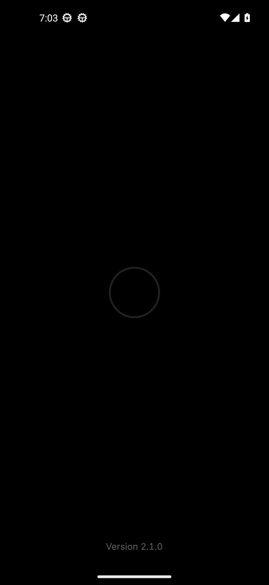
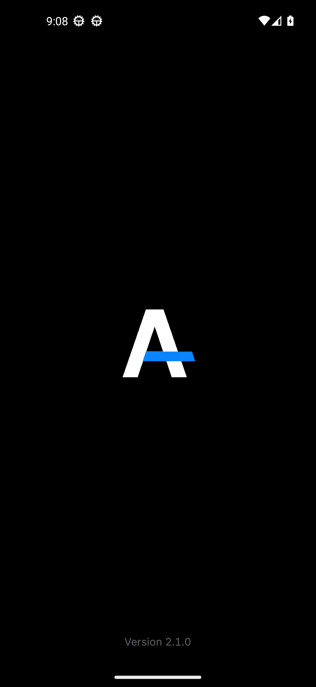
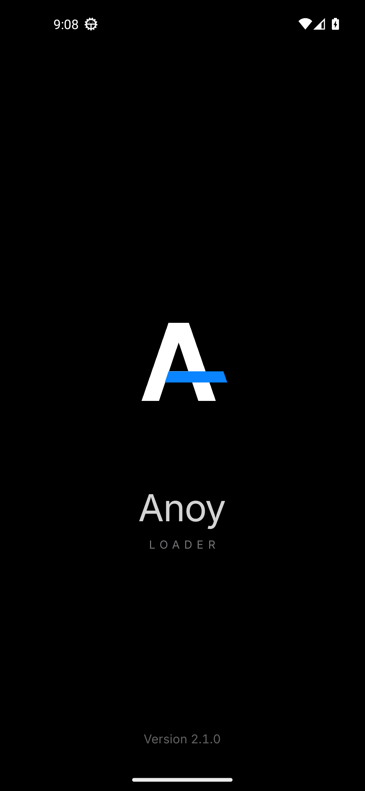

# Follow-up: Anoy monogram, launch error, home tidy

All shots are in [`after/`](after/) and were captured by CI on the API 33
Pixel 5 emulator from the real debug APK (run 45, commit `a04d490`). Stills are
taken with animations off; the splash frames are pinned with the debug-only
`qa_frame` extra, so they are the real Lottie frames rather than mock-ups.

## 1. Splash: the Anoy monogram

The ring / arc / notch / collapse-to-dot animation is gone. The new splash is
the same "A" monogram as the app icon:

| System splash | Frame 0 | Bar draws | Settles | Wordmark | Final |
|---|---|---|---|---|---|
|  |  |  |  |  |  |

- **0.0 s**: a plain white A at 96 %. This frame *is* the system splash icon
  (`splash_mark.xml`), so the handoff from Android's own splash has no jump.
- **0.1 – 0.7 s**: the blue `#0A84FF` crossbar draws through the A and past the
  right leg (expo-out easing) while the mark settles to 100 %.
- **0.7 – 1.2 s**: the mark lifts; "Anoy" (Inter semibold) and the tracked
  "LOADER" fade in under it. "Version 2.1.0" stays at the bottom.
- **~1.9 s**: hand-off to sign-in / the update check, unchanged.
- If start-up takes longer, the monogram slowly breathes its opacity
  (`splash_f085`). There is no spinner, bounce, gradient or glow.
- Reduced motion (animations off) shows the final mark and wordmark, then
  cross-fades as before.

The animation is original, authored in the repo (`scripts/lottie_art.py`,
2 KB, 60 fps, 120 frames). Provenance is in
`app/src/main/assets/licenses/LOTTIE.md`.

## 2. App icon

| App drawer | Recents | Mask shapes (rendered from the vector) |
|---|---|---|
|  |  |  |

- Adaptive icon: `#0A0A0A` background, the white A with its blue crossbar in
  the foreground, inside the 66 dp safe zone (red dashed circle above), so
  circle, squircle, rounded-square and teardrop masks never clip it.
  [`brand/icon_masks_48.png`](brand/icon_masks_48.png) is the same at 48 px.
- The legacy icon (Android 5–7) is the same artwork on a rounded tile.
- One geometry (`scripts/brand_mark.py`) generates the adaptive icon, the
  legacy icon, the system-splash icon and the splash animation.
- The login screen's small key tile is unchanged.
- The emulator image has no icon-shape overlays, so the drawer shot shows the
  Pixel launcher's default circle. The other shapes are covered by the render.

## 3. No false "Couldn't launch the game"

`MAct.launchGame()` used to wrap the launch *and* the after-launch UI in one
`try/catch`, and treated a null launch intent as a failure. Now:

- Once `startActivity` returns, the launch counts as a success. The
  after-launch work (haptic, hiding messages, refreshing the state) is in its
  own `try` and can only log, never show the error.
- With a null intent, or if starting throws, Anoy waits up to 4 s for the game
  to actually start (the container reports it running, or Anoy is sent to the
  background) before reporting a failure. The real exception is logged.
- When you come back to Anoy while the game is running, any stale error is
  cleared. The pre-launch checks and their messages are unchanged.

| Started, back to Anoy | After-launch step throws | Null intent, game running | Real failure |
|---|---|---|---|
|  |  |  |  |

The emulator has no BGMI, so these cases are simulated with the debug-only
`qa_launch` extra. CI fails if a started case shows the error or if a real
failure hides it.

## 4. Home tidy

| Typical phone (411 × 914 dp) | Pixel 5 (393 × 851 dp) |
|---|---|
|  |  |

- Tighter vertical rhythm (rows 56 → 52 dp, section gaps 28 → 24 dp, smaller
  top and card spacing). On a typical phone the DEVICE card ends about 37 dp
  above the Launch bar; CI measures this from the view bounds.
- The notice keeps its last two words together and breaks into even lines, so
  "ban." is never left on its own line.
- Model / Android values stay on one right-aligned line, shrink down to 12 sp,
  then end with "…".
- On the shorter Pixel 5 screen the last DEVICE row still sits under the
  Launch bar until you scroll a little; fitting it there would need more than
  a light clean-up.
