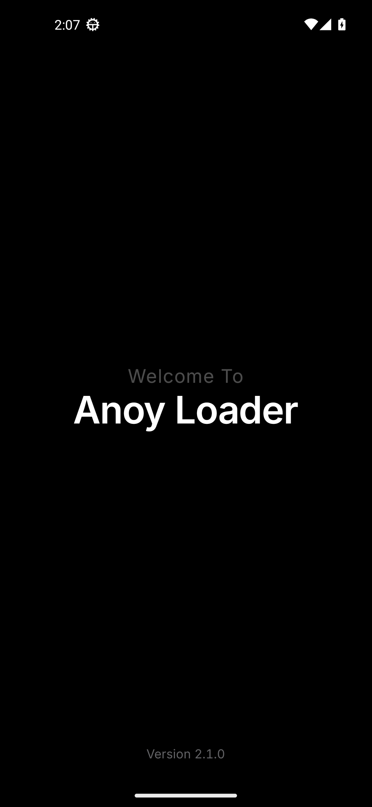
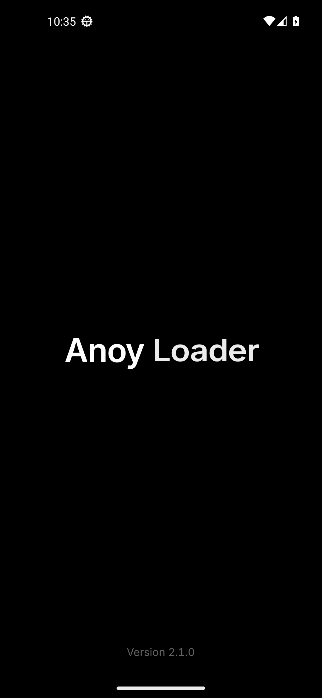
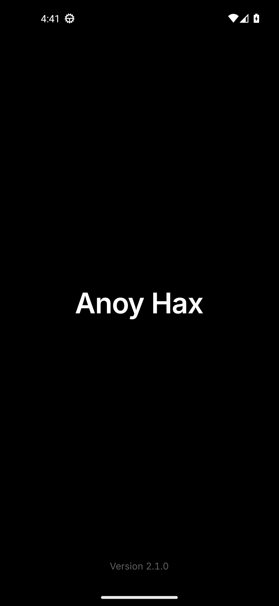

# Follow-ups: Anoy wordmark and splash film, launch error, home tidy

All shots are in [`after/`](after/) and were captured by CI on the API 33
Pixel 5 emulator from the real debug APK. Stills are taken with animations
off; the splash stills are pinned with the debug-only `qa_frame` extra (a film
time in seconds), so they are real frames of the film, not mock-ups.
`after/anim_splash.mp4` is a screen recording of a cold start with animations
on.

## 1. App icon: the word "Anoy", white on black

| App drawer | Recents | Masks, 48 px and enlarged |
|---|---|---|
|  |  |   |

The A monogram, its blue bar and the key are gone. The icon is only the word
**Anoy**, `#FFFFFF` on `#000000`, drawn as vector outlines (not a TextView).
Made by `scripts/brand_wordmark.py` from Inter 4.001, the version the app ships:

- **Weight 660** (SemiBold is 600), text optical size, so it stays crisp at 48 dp.
- **Tracking** -2.5 % of the em; **A–n** tightened a further 3.5 % for the hole
  under the A's open right side. n–o–y keep Inter's own optical spacing.
- **y descender**: the hook is lifted 26 % along the y's own diagonal, tapered
  to nothing at the crotch, so the tail is shorter without getting thinner.
- **Optical centring**: halfway between the ink centroid and the box centre
  horizontally; cap band blended with the ink centroid vertically.
- **Size**: the farthest point is 31 dp from the centre, 2 dp inside the 66 dp
  safe zone. Circle, squircle, rounded-square and teardrop masks never clip a
  letter (red dashes above = safe zone). On a 48 dp icon the word is 40 dp wide
  with a 12 dp cap height.
- The adaptive icon (`drawable-v26`), the legacy rounded square (`drawable`)
  and the system-splash icon (`splash_mark.xml`) are all generated from the
  same outlines. The login screen's key tile is unchanged.
- The emulator has no icon-shape overlays, so the drawer shows the Pixel
  launcher's circle; the other masks are rendered from the vector.

## 2. Splash: "Welcome To Anoy Loader" → "Anoy Hax"

| System splash | Welcome | Greeting dissolving | Loader → Hax mid-dissolve | Final |
|---|---|---|---|---|
|  |  |  |  |  |

The splash is now real TextViews on true black, driven by one animator, so the
three cut moves share one clock. Text changes use the Material 3 emphasized
ease `(0.2, 0, 0, 1)` (gentle start, long settle), and the moving text is
drawn from hardware layers during the film so glyphs are not re-rasterised
every frame. Timings, all named constants in
`SplashActivity`:

| Time | Beat | What moves |
|---|---|---|
| 0.00 s | hand-off | first frame = the system splash wordmark, same place and size (`splash_t000` is identical to `splash_live_cold`); the system splash is removed instantly instead of fading over an empty window |
| 0.00–0.50 s | arrive | "Welcome To / Anoy Loader" fades in (400 ms) and rises 12 dp (500 ms, emphasized decelerate); the system wordmark cross-fades out in 220 ms |
| 0.50–1.20 s | read | hold |
| 1.20 s | leave | "Welcome To" dissolves: fades out while drifting up 10 dp and easing to 98 % (420 ms, smooth ease). No clipping; it only turns invisible once fully transparent |
| 1.28 s | move | "Anoy Loader" eases up so its cap band sits on the true screen centre (460 ms, emphasized decelerate) |
| 1.36 s | swap | "Loader" cross-dissolves into "Hax" in the same slot (start edges aligned, overlapping fades that never dim the slot, a 1.0 ↔ 0.98 breath) while the pair slides to centre. Fade and slide share one 400 ms progress and one smooth ease, so "Anoy" glides sideways once |
| ~1.80–2.85 s | settle | hold "Anoy Hax"; the version stays at the bottom |
| 2.85 s | hand-off | the existing 320 ms cross-fade into sign-in / the update check (done ~3.17 s) |

- "Welcome To" is Inter Regular 20, tracked +4 %, 72 % white. "Anoy",
  "Loader" and "Hax" are Inter SemiBold 40, full white, separate views.
- **Reduced motion** (animations off): the welcome lockup holds 1 s, cuts
  straight to "Anoy Hax", holds 0.7 s and hands off. Shown in
  `splash_reduced_welcome.png` and `splash.png`.
- **Slow start-up**: "Anoy Hax" stays and breathes its opacity very slowly
  (100 → 72 %, 2.4 s). No spinner, bounce, glow or extra logo.
- The splash no longer uses Lottie; `anoy_mark.json` was deleted. The two
  update-check animations are unchanged.

## 3. No false "Couldn't launch the game"

`MAct.launchGame()` used to wrap the launch *and* the after-launch UI in one
`try/catch`, and treated a null launch intent as a failure. Now:

- Once `startActivity` returns, the launch counts as a success. The
  after-launch work (haptic, hiding messages, refreshing the state) is in its
  own `try` and can only log, never show the error.
- With a null intent, or if starting throws, Anoy waits up to 4 s for the game
  to actually start (the container reports it running, or Anoy is sent to the
  background) before reporting a failure. The real exception is logged.
- When you come back to Anoy while the game is running, any stale error is
  cleared. The pre-launch checks and their messages are unchanged.

| Started, back to Anoy | After-launch step throws | Null intent, game running | Real failure |
|---|---|---|---|
|  |  |  |  |

The emulator has no BGMI, so these cases are simulated with the debug-only
`qa_launch` extra. CI fails if a started case shows the error or if a real
failure hides it.

## 4. Home tidy

| Typical phone (411 × 914 dp) | Pixel 5 (393 × 851 dp) |
|---|---|
|  |  |

- Tighter vertical rhythm (rows 56 → 52 dp, section gaps 28 → 24 dp, smaller
  top and card spacing). On a typical phone the DEVICE card ends about 37 dp
  above the Launch bar; CI measures this from the view bounds.
- The notice keeps its last two words together and breaks into even lines, so
  "ban." is never left on its own line.
- Model / Android values stay on one right-aligned line, shrink down to 12 sp,
  then end with "…".
- On the shorter Pixel 5 screen the last DEVICE row still sits under the
  Launch bar until you scroll a little; fitting it there would need more than
  a light clean-up.

## 5. Game files (OBB) copied before launch

`AppManager.copyObbAsync` (called by `MAct.prepareObbThenLaunch()` after the
activation, library and files-access checks) now:

1. Finds the source in `/storage/emulated/0/Android/obb/<pkg>` or
   `getExternalStorageDirectory()/Android/obb/<pkg>`: the newest `main.*.obb`
   plus the newest `patch.*.obb`.
2. Resolves the container folder
   (`MetaStorageManager.obtainAppExternalStorageDir(pkg)/Android/obb/<pkg>`),
   retrying 5 × 600 ms if it is missing or is the device folder.
3. Skips a file only if the container copy is a different canonical file with
   the same name and size; otherwise copies (temp + rename, whole-job percent)
   and verifies.
4. Launch runs only after success. Errors: `error_obb_missing` (folder or main
   OBB not found), `error_obb_copy` with a reason (folder blocked by Android,
   container not ready, write / incomplete / verify failure, no space).

Debug log tag `AppManager`: source, destination, copy / skip per file, sizes,
progress at 0/25/50/75/100 %.

Emulator proof (API 33, fake 320 MB main + 24 MB patch + an older main):
container folder `/storage/emulated/0/Android/obb/com.xlox/scopedStorage/com.pubg.imobile/Android/obb/com.pubg.imobile`
(different from the device folder); first launch copied and verified both
files, then launched; second launch skipped both as current, then launched;
no OBB → "Game files not found", no launch.

**Android 11+ limit:** stock Android only lets "installer" apps read another
app's `Android/obb` folder. Anoy does not ask for "Install unknown apps", so on
such phones the folder is unreadable and Launch says Android is blocking it
(no launch). The emulator copy test turns that access on with a test-only
`appops` switch; the app itself does not request it.

